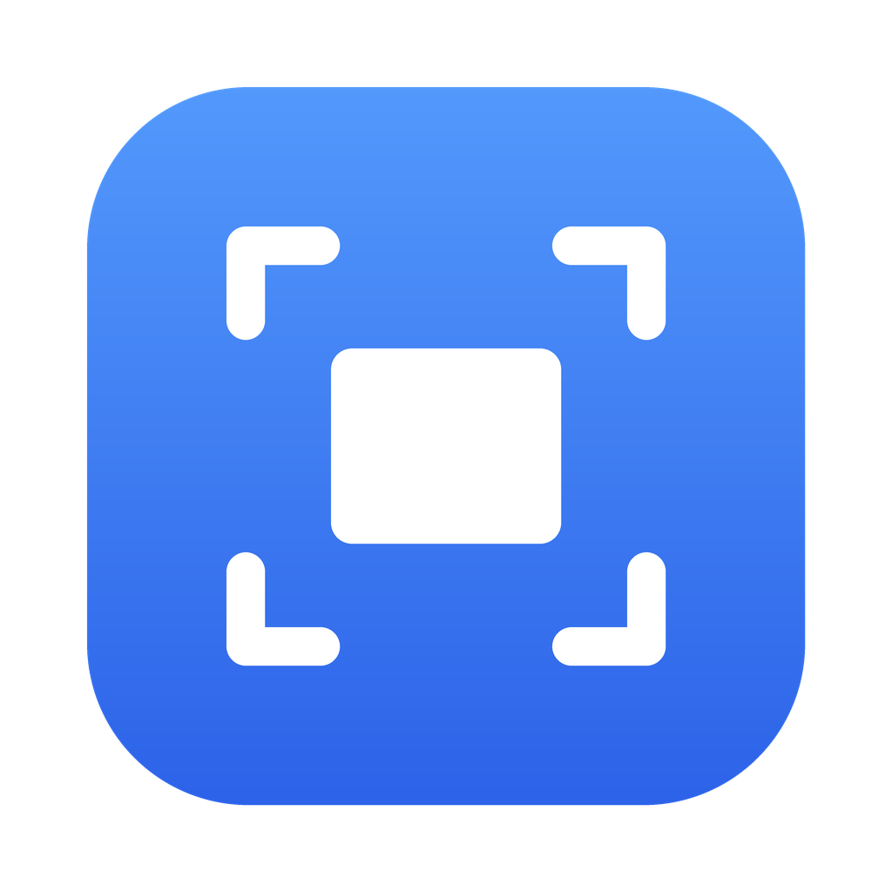

# MiniShot



一个轻量的 Mac 截图工具，常驻菜单栏，支持截图、标注、打码和长截图。

适用于 Apple Silicon（M 系列）Mac，需要 macOS 14 或更高版本。

## 功能

**截图**（默认 `⌃⇧A`）
- 按下快捷键时先冻结屏幕，弹出的菜单、悬停提示也能截到
- 拖拽框选；单击选中鼠标下的窗口，没有窗口时选中整块屏幕
- 选区可以拖动、拖控制点调整大小，方向键微调 1pt（按住 ⇧ 每次 10pt）
- 放大镜显示像素坐标和颜色，按 `C` 复制颜色值
- 支持多显示器和 Retina 屏，按原始像素输出

**标注**：矩形、椭圆、箭头、直线、画笔、荧光笔、文字、序号
- 7 种颜色、3 档粗细；按住 ⇧ 画正方形、正圆、45° 直线
- 标注可以选中后移动、调整大小，按 ⌫ 删除，双击文字重新编辑
- 撤销 `⌘Z`，重做 `⇧⌘Z`

**打码**：马赛克或模糊，区域可以是矩形框选或画笔涂抹，导出时直接写入像素

**长截图**（默认 `⌃⇧L`，或在截图工具栏点「长截图」）
- 手动滚动（默认）：框选区域后自己向下滚动，MiniShot 在后台截取并拼接
- 自动滚动：自动向下滚到底部，需要辅助功能权限
- 自动识别网页导航栏、聊天输入框这类固定的头部和底部，只保留一份
- 按 Esc 或点「完成」结束，结果在编辑窗口里打开，可以继续标注、打码

**输出**
- `↩`、双击选区或点 ✓：按设置复制到剪贴板、保存到文件，或两者都做
- `⌘C` 只复制，`⌘S` 只保存
- 保存位置和格式（PNG / JPG）在设置里修改，默认保存到桌面

## 下载安装

1. 在 [Releases](../../releases) 页面下载 `MiniShot.zip`（或在 Actions 每次构建的 Artifacts 里下载）
2. 解压，把 `MiniShot.app` 拖进「应用程序」
3. App 没有经过苹果公证，第一次打开前在终端运行：
   ```sh
   xattr -cr /Applications/MiniShot.app
   ```
4. 打开 App，按提示在 系统设置 → 隐私与安全性 → 录屏与系统录音 中打开 MiniShot，然后**重新打开** MiniShot
5. 需要自动滚动长截图时，在设置里授予辅助功能权限

App 使用 ad-hoc 签名，**每次更新到新版本后都需要重新授予屏幕录制权限**（先在系统设置里把旧的 MiniShot 条目删掉再添加）。

## 从源码构建

```sh
xcode-select --install
make            # 生成 build/MiniShot.app
make test       # 运行长截图对齐与拼接的单元测试
make install    # 复制到「应用程序」并打开
```

推送到 `main` 会自动构建；推送 `v*` 标签（如 `git tag v0.1.0 && git push --tags`）会发布 Release。

## 代码结构

| 路径 | 说明 |
|---|---|
| `Sources/MiniShotCore/` | 长截图算法：灰度帧、逐行哈希求偏移（Vision 兜底）、固定区域检测、拼接 |
| `Sources/MiniShot/CaptureController.swift` | 串起截图、长截图、编辑窗口的流程 |
| `Sources/MiniShot/OverlaySession.swift`、`SelectionView.swift` | 全屏浮层：框选、窗口吸附、放大镜、工具栏位置 |
| `Sources/MiniShot/CanvasView.swift`、`Annotations.swift` | 标注画布和各类标注、打码、导出合成 |
| `Sources/MiniShot/ScrollSession.swift` | 长截图的截取循环、自动滚动、预览面板 |
| `Sources/MiniShot/ScreenGrabber.swift` | ScreenCaptureKit 截屏、窗口列表 |
| `Sources/MiniShot/HotKeys.swift` | 全局快捷键（Carbon，无需额外权限）和快捷键录制 |
| `Tests/MiniShotCoreTests/` | 用合成图验证偏移计算和拼接能逐像素还原原图 |
